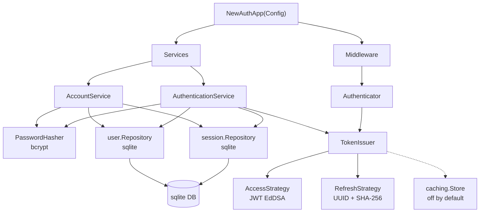

# basic-auth

Not ready yet. 

Cookie based authentication for Go services: register, login, refresh, logout. Every part sits behind an interface and has a default, so it works with zero config and any part can be swapped.

## Quick start

```sh
go get github.com/markusnieminen1/basic-auth
```

```go
app, err := basicauth.NewAuthApp(basicauth.Config{}) // bcrypt, JWT, sqlite (./auth.db), UUID refresh tokens
if err != nil {
	log.Fatal(err)
}
defer app.Close()
if err = app.ConfigTest(ctx); err != nil { // optional: self-check on a private temporary DB
	log.Fatal(err)
}

user, err := app.AccountService.Register(ctx, sharedmodels.RegisterInput{Email: "a@b.fi", Username: "alice", Password: "Sup3r-secret!"})
cookies, err := app.AuthenticationService.Login(ctx, sharedmodels.LoginInput{Username: "alice", Password: "Sup3r-secret!"}) // set these on the response
userID, err := app.Authenticator.Authenticate(ctx, cookies)      // validate the access token
cookies, err = app.AuthenticationService.Refresh(ctx, cookies)   // new tokens, the old refresh token is revoked
expired, err := app.AuthenticationService.Logout(ctx, cookies)   // revoke, then set these to overwrite the client's tokens
```

```go
// Get the user id from request (int64)
userId := basicauth.handlers.UserID(r)
```


The app does the work, the HTTP layer is yours. Ready made handlers and middleware (`app.Middleware`, package `handlers`) exist but are optional.

Replace a default by setting its `Config` field: `Hasher`, `Access`, `Refresh`, `Users`, `Sessions`, `Cache` (none by default), or `DB` to use your own sqlite database.

## Components


